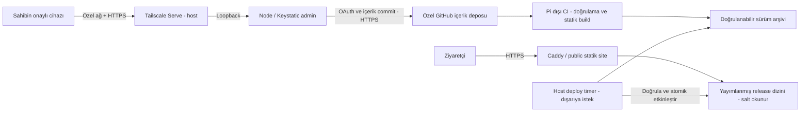

# Kişisel geliştirici portföyü — mimari öneri

Tarih: 16 Kasım 2026 · Durum: **Faz 0–1 onaylandı; yerel uygulama ilerletildi.** Güncel kanıtlar ve kapsam: [uygulama durumu](IMPLEMENTATION.md).

## 1. Kapsam ve doğrulanmış durum

Amaç; AI/ML ve sistem mühendisliği çalışmalarını, kişisel projeleri, seçilmiş Babintech projelerini, teknik yazıları, öğretici rehberleri ve mesleki deneyimi erişilebilir, hızlı bir sitede sunmak. İlk barındırma hedefi Raspberry Pi 5 / 4 GB RAM, Linux ve Docker Compose; tercih edilen arayüz teknolojileri Astro, TypeScript ve Tailwind CSS. Özel içerik yönetimi kullanıcı gereksinimidir.

### İlk planlama incelemesinde doğrulanan olgular

İncelenen çalışma dizini: `/home/eck/Projects/portfolio`.

| Bulgu | Kanıt / sınır |
| --- | --- |
| Sürüm kontrolündeki tek dosya `LICENSE` | `git ls-tree -r --name-only HEAD` ve dosya listesi |
| MIT lisansı, 2026 Efe Can Kara telif kaydı | `LICENSE` içeriği |
| HEAD: `f8818c6`, `Initial commit` | `git log -5 --oneline` |
| İnceleme başlangıcında çalışma ağacı temiz | `git status --porcelain=v1 --untracked-files=all` boş |
| Uygulama ve altyapı tanımları bulunmuyor | Paket bildirimi, kilit dosyası, Astro/TypeScript/Tailwind yapılandırması, Dockerfile, Compose, test veya CI dosyası yok |
| Uygulanabilir yerel `AGENTS.md` bulunamadı | Depo, taranan üst dizinler ve proje çevresi kontrol edildi |
| `.agents`, `.codex`, `.aws` dizinlerinde dosya bulunamadı | İçerikleri yapılandırma veya kimlik bilgisi varlığının kanıtı değildir |

İlk planlama incelemesi Pi cihazına bağlanmadı. Alan adı, GitHub uzak deposu/görünürlüğü, mevcut sunucu, işletim sistemi sürümü, disk, ağ ve hesap izinleri o aşamada doğrulanmadı. İlk adımda yalnızca bu öneri ve [yol haritası](ROADMAP.md) oluşturulmuştu. Sonraki onayla eklenen kod, bağımlılıklar ve yerel testler [uygulama durumunda](IMPLEMENTATION.md) kayıtlıdır; aşağıdaki tasarım hedeflerinin tamamı uygulanmış sayılmaz.

### Planlama varsayımları

- Başlangıçta tek editör ve düşük/orta trafik var; çok kullanıcılı onay akışı gerekmiyor.
- İçerik yayımlandıktan birkaç dakika sonra görünmesi yeterli; her istekte dinamik veri gerekmiyor.
- Yönetim için VPN kullanımı ve GitHub hesabıyla giriş kabul edilebilir.
- Pi'de 64 bit Linux, kalıcı SSD, yeterli güç ve soğutma sağlanabilir. Bunlar henüz mevcut kabul edilmiyor.
- CI derlemelerinin Pi dışında yapılması için GitHub Actions veya eşdeğer bir ortam kullanılabilir; kota/maliyet henüz bilinmiyor.
- İlk sürüm tek dilde olabilir. İçerik dili, alan adı ve görsel kimlik kullanıcı tarafından seçilecek; bu belgelerin Türkçe olması site dilini belirlemez.

Varsayım değişirse ilgili karar yeniden ele alınır; aşağıdaki kaynak bütçeleri ölçüm değil başlangıç hedefidir.

## 2. Önerilen karar ve seçenekler

**Öneri: herkese açık statik Astro sitesi + ayrı ve özel Keystatic yönetim servisi; başlangıçta uygulama veritabanı yok.** İçeriğin asıl kaynağı özel bir GitHub içerik deposu olur. Keystatic üretimde GitHub modunda çalışır. Kamuya açık site, bu içerikten üretilmiş HTML/CSS ve seçilmiş medyayı sunar; Node, CMS ve GitHub ziyaretçi isteğinin yolunda bulunmaz.

Astro içerik koleksiyonları dosya tabanlı içeriğin şemayla doğrulanmasını ve derlemede okunmasını destekler. Bu özellik statik üretim tercihinin teknik temelidir. [Astro içerik koleksiyonları](https://docs.astro.build/en/guides/content-collections/)

| Boyut | A — Astro + Keystatic / Git dosyaları | B — Astro + ayrı backend / veritabanı |
| --- | --- | --- |
| Somut yapı | Statik site, özel Node yönetim servisi, özel Git içerik deposu, CI | Statik site, özel Django admin + içerik dışa aktarma uç noktası; başlangıçta SQLite, gerekirse PostgreSQL |
| Sürekli Pi yükü | Statik sunucu + yönetim için bir Node süreci | Statik sunucu + backend süreci; PostgreSQL seçilirse ek DB süreci |
| Yönetim | Hazır şema tabanlı editör; GitHub giriş/yazma izni | Hazır admin ve uygulama kullanıcıları; MFA için ayrıca olgun entegrasyon gerekir |
| İçerik geçmişi | Git commit ve dal geçmişi | Revizyon/audit modeli ayrıca tasarlanır; DB yedeği gerekir |
| Yayınlama | Commit → doğrulama → statik derleme → etkinleştirme | İşlemsel içerik snapshot'ı → dışa aktarma → aynı statik hat |
| Artılar | Taşınabilir içerik, az kalıcı servis, kolay geri alma | İlişkisel sorgular, daha gelişmiş roller ve iş akışları, GitHub'dan bağımsız düzenleme |
| Maliyet/risk | GitHub/CI bağımlılığı, dal ve yayınlama disiplini, CMS/Astro sürüm uyumu | İkinci uygulama yığını, oturum/MFA, migrasyon, DB tutarlılığı ve yedek yönetimi |
| Uygun kullanım | Tek editörlü portföy ve teknik yayınlar | Birden fazla editör, yoğun eşzamanlı yazma, karmaşık onay ve ilişki gereksinimi |

B seçeneği 4 GB üzerinde peşinen olanaksız değildir; tüketim ölçülmelidir. Django admin, sıfırdan bir yönetim paneli yazma maliyetini azaltır, ancak Python bakımını da ekler. SQLite aynı makinede tek editör için değerlendirilebilir; ağ dosya sistemine konmaz. Sürekli yazma çakışması/`database is locked` görülürse veya eşzamanlı yazar gereksinimi doğarsa PostgreSQL'e geçilir. Üretim sunucusu, güvenli ayarlar ve yedekler yine gerekir. [Django dağıtım kontrolü](https://docs.djangoproject.com/en/stable/howto/deployment/checklist/), [SQLite sınırlamaları](https://docs.djangoproject.com/en/stable/ref/databases/#sqlite-notes)

Decap gibi Git tabanlı CMS'ler de A ailesindedir; backend/OAuth servisinin işletilmesi yine değerlendirilmelidir. Başlangıçta iki CMS birden kurulmaz. Keystatic uyumluluk denemesini geçemezse alternatif için ayrı karar kaydı hazırlanır. Sıfırdan CMS, parola sistemi, Redis, Kubernetes veya sürekli çalışan görev kuyruğu başlangıç ihtiyacı değildir.

**B'ye geçiş tetikleyicileri:** çevrimdışı/GitHub'dan bağımsız yönetim zorunluluğu, eşzamanlı çoklu editör, kayıt bazında yetkilendirme, karmaşık işlemsel iş akışı veya ölçülmüş Git/derleme darboğazı. İçerik dosyalarındaki kalıcı kimlikler ve şema sürümleri sonraki DB aktarımını kolaylaştırır.

## 3. Kaynak, içerik ve derleme sınırları

Önerilen yapıda mevcut depo uygulama kodunu, şemaları, dağıtım tanımlarını ve bu belgeleri taşıyacak. Taslaklar ve ham medya için **ayrı özel içerik deposu** önerilir; henüz oluşturulmadı. Mevcut deponun görünürlüğü bilinmediğinden taslakları burada saklamanın güvenli olduğu varsayılmaz. MIT lisansı, Babintech metin/görsel/müşteri materyali için otomatik yayın izni sayılmaz; içerik lisansı ve atıfları ayrıca tanımlanır.

İki ayrı derleme hedefi kullanılır:

- **Public:** Astro statik çıktı. Keystatic entegrasyonu ve yönetim rotaları bu hedefte hiç eklenmez. Yönetim JavaScript'i, API, kaynak içerik, `.git`, ortam dosyaları ve taslaklar çıktıya girmez.
- **Admin:** Astro Node adapter ile üretim sunucusu ve Keystatic. Yalnızca özel ağda çalışır. CMS'nin React bağımlılığı public sayfalara hydration yükü getirmez. Geliştirme sunucusu üretime konmaz.

Ortak TypeScript içerik sözleşmeleri ve doğrulayıcılar tekrar kullanılır. Başlangıçta aynı depoda ayrı Astro yapılandırmaları yeterlidir; monorepo aracı zorunlu değildir. Keystatic'in resmi şablonu sunucu çıktısı/Node adapter kullanır; public derlemede entegrasyonun çıkarılması da belgelenmiştir. İki hedefin paket/sürüm uyumu ilk teknik denemede doğrulanacaktır. [Resmi Astro şablonu](https://github.com/thinkmill/keystatic/blob/main/templates/astro/astro.config.mjs), [yönetim rotalarını çıkarma](https://keystatic.com/docs/recipes/astro-disable-admin-ui-in-production)

Tailwind için güncel resmi Astro/Vite entegrasyonu temel alınır. Uygulamada desteklenen ve CMS ile uyumlu Astro/Node/Tailwind sürümleri seçilip kilitlenir; burada belirli bir sürümün uyumluluğu vaat edilmez. [Tailwind Astro kılavuzu](https://tailwindcss.com/docs/installation/framework-guides/astro)

### Yayınlama sözleşmesi

1. Editör CMS'de kaydeder; değişiklik özel içerik deposunda commit olur. `draft` kaydı yayımlama değildir.
2. İçerik deposundaki güvenilen CI, kodun onaylı commit'ini ve içeriğin belirli commit'ini alır. Rastgele içerik dalından build betiği çalıştırılmaz. Kod değişikliği de son onaylı içerik snapshot'ıyla derleme tetikler.
3. Şema, ilişkiler, yayın izni ve medya kontrollerinden sonra **yalnızca yayımlanabilir içerik ve onun medyası** ara dizine aktarılır. Public Astro derlemesi yalnızca bu dizini okur.
4. Derleme ve kontroller geçerse sürümlenmiş statik arşiv, hash ve manifest üretilir. Manifest; kod/içerik commit'lerini, şema sürümünü, GitHub metadata snapshot kimliğini ve build zamanını içerir; sır içermez.
5. Pi'deki sınırlı yetkili host görevi, örneğin beş dakikada bir, yalnızca güvenilen başarılı sürümü indirir. Kimlik/provenance ve bütünlük doğrulanır; arşiv path traversal, symlink ve boyut sınırlarıyla güvenli açılır.
6. Yeni sürüm ayrı dizinde doğrulanır; aynı dosya sistemindeki `current` işaretçisi atomik değiştirilir. Hata varsa mevcut sürüm sunulmaya devam eder. İçerik güncellemesi için konteyner rebuild/restart gerekmez.

Önerilen aktarım, özel içerik deposunda CI'nin ürettiği sürümlü release varlıklarıdır. Pi yalnızca gerekli depoya okuma yetkili kimlikle çeker; internetten webhook veya CI SSH girişi gerekmez. Güven modeli salt arşivin içindeki checksum'a dayanmaz: beklenen CI üreticisi/iş akışı ve imzalı manifest doğrulanır. İmza/anahtar veya attestation yöntemi ilk dağıtım denemesinde somutlaştırılır.

İşler tekilleştirilir; geç biten eski build yeni sürümü ezemez. Deploy görevi onaylı kanalın en yeni başarılı manifestini tekrar kontrol eder. İçerik silme/yayından kaldırma da yeni tam çıktı üretir. Son iki sürümün asset'leri kısa bir geçiş penceresinde sunularak eski HTML açık olan tarayıcılarda 404 önlenir; hassas içerik kaldırmada ilgili asset ve varsa CDN önbelleği özellikle temizlenir.

İlk sürümde yayın anı `status=published` ve geçerli `publishedAt` ile belirlenir. Gelecek tarihli yayın reddedilir; takvimli yayın ayrı fazdadır. CMS kaydı, build başarısı ve canlı sürüm farklı durumlardır; başlangıçta CI sonucu ve özel operasyon manifestinden izlenir. CMS'nin özel bir “canlıya çıktı” ekranı sunduğu varsayılmaz.

## 4. İçerik modelleri

Metin için kısıtlı Markdoc (`.mdoc`), yapılandırılmış veriler için JSON/YAML önerilir. Kullanıcı içeriğinde çalıştırılabilir MDX/JavaScript ve sınırsız ham HTML kullanılmaz. CMS alanları ile build doğrulaması aynı sözleşmeye uyar; CMS form doğrulaması tek güvenlik sınırı değildir.

| Model | Alanlar ve ilişkiler |
| --- | --- |
| Ortak yayın alanları | Değişmez `id`, `schemaVersion`, `slug`, `locale`, `title`, `summary`, `status: draft/published/archived`, `createdAt`, `updatedAt`, `publishedAt`, `tags`, `seo`, isteğe bağlı `coverMediaId` |
| `Post` | Ortak alanlar, `body`, `category`, `relatedProjectIds`, kaynak bağlantıları; okuma süresi build'de hesaplanır |
| `Guide` | Ortak alanlar, `body`, `level`, ön koşullar, öğrenme hedefleri, sıralı bölüm kimlikleri, `testedVersions`, `lastVerifiedAt`, kaynak/kod bağlantıları; bölümler ayrıysa kendi yayın durumları denetlenir |
| `Project` | Ortak alanlar, `origin: personal/babintech`, `role`, dönem, problem, yaklaşım, mimari, kanıtlı sonuçlar, teknoloji listesi, demo/kod/yazı bağlantıları, `githubRepoId`, `repoVisibility`, `publicationApproval`, medya ilişkileri |
| `Experience` | `id`, kurum, rol, başlangıç/bitiş veya halen sürüyor bilgisi, özet, doğrulanabilir çıktılar, beceriler, ilgili proje kimlikleri, sıralama, yayın durumu |
| `Page` | Ortak alanlar ve izinli içerik blokları; hakkında ve benzeri sabit sayfalar |
| `SiteSettings` — tekil | İsim, profesyonel unvan, biyografi, iletişim/sosyal bağlantılar, gezinme, ana dil, site URL'si, varsayılan SEO, sıralı `featuredProjectIds`, ana sayfa bölümleri |
| `Media` | `id`, yerel kaynak yolu, MIME, boyut, genişlik/yükseklik, alt metin veya dekoratif işareti, atıf/lisans, yayın onayı; yalnızca referans verilen onaylı dosyalar public çıktıya taşınır |
| `GitHubRepoSnapshot` — üretilir | Repo kalıcı kimliği, `owner/name`, public URL, açıklama, konu/ana dil, yıldız/fork, arşiv durumu, son push, `fetchedAt`; editoryal veriyle ayrı tutulur |
| `Redirect` | Eski yol, yeni yerel yol, 301/308; döngü ve harici açık yönlendirme kontrolü |

`seo`: başlık/açıklama geçersiz kılmaları, canonical geçersiz kılma gerekçesi, paylaşım medyası ve index tercihi. Canonical varsayılanı onaylı site URL'sinden türetilir. Eksik çeviri zorunlu tutulmaz; çok dil açılırsa içerikler `translationGroupId` ile eşlenir.

### Bütünlük ve sızıntı kuralları

- Slug yol bileşeni olarak güvenli ve koleksiyon/dil içinde tekildir; URL değişiminde yönlendirme kaydı gerekir. Kimlik slug'dan bağımsızdır.
- Tarihler ISO 8601 / UTC saklanır; arayüzde seçilen yerel saat diliminde gösterilir. Güncelleme tarihi gerçek değişiklikle ilerler.
- `published` kayıt için başlık, özet, gövde, tarih ve gerekli yayın izinleri zorunludur. Bozuk ilişki ve yinelenen featured kimliği build'i durdurur.
- Featured liste yalnızca yayımlanmış projelere referans verebilir. Sitemap, RSS, arama indeksi, JSON-LD, ilişkili içerik ve istemci payload'ları aynı yayın filtresini kullanır.
- Taslaklar `noindex` ile korunmuş sayılmaz; public arşivde ve asset'lerde bulunmaz. Taslak medyası Astro `public/` içine topluca kopyalanmaz. CI log/cache/artifact'leri de özel tutulur; tüm workspace artifact yapılmaz.
- Babintech projelerinde yayın onayı bilinmiyorsa varsayılan `draft`tır. Müşteri adı, ekran görüntüsü, repo bağlantısı ve performans rakamları ayrıca incelenir. Özel repo metadata'sı ve erişim adresleri otomatik yayımlanmaz.
- Medya için başlangıç sınırı 10 MiB ve 24 megapiksel; MIME/imza kontrolü, yeniden kodlama ve EXIF temizliği uygulanır. Aktif SVG/HTML yükleme kapalıdır. İndirme URL'leri keyfi verilmez; SSRF oluşturacak sunucu tarafı URL alma özelliği başlangıçta yoktur.

## 5. Yönetim erişimi ve kimlik doğrulama

**İki katman:** Tailscale özel ağ erişimi + Keystatic GitHub oturumu. Keystatic GitHub modunda repo yazma yetkisi giriş kriteridir; bu nedenle içerik deposunda başlangıçta yalnızca sahip yazabilir. Tüm repo yazarlarının editör olabileceği açıkça kabul edilmelidir. GitHub App yalnızca özel içerik deposuna kurulur; uygulama kodu deposuna yazamaz. Gerekli izinler uyumluluk denemesinde kaydedilir, gereksiz izin verilmez. [Keystatic GitHub modu](https://keystatic.com/docs/github-mode)

- Host üzerinde Tailscale; admin konteynerinin portu yalnızca host loopback adresine yayımlanır, örneğin `127.0.0.1:4321:4321`. Node konteyner içinde port yönlendirmesini kabul edecek arayüzde dinler. Tailscale Serve, HTTPS üzerinden host loopback servisine eriştirir. Tailnet politikası varsayılan kapalı, yalnızca sahibin onaylı cihazlarına izinli olur. Public Funnel kullanılmaz. [Tailscale Serve](https://tailscale.com/docs/features/tailscale-serve)
- GitHub ve VPN kimlik sağlayıcısında MFA/passkey; kurtarma kodları Pi dışında tutulur. Cihaz kaybında VPN yetkisi, repo erişimi ve uygulama oturumu/token'ları birlikte iptal edilir.
- OAuth dönüş adresi özel HTTPS yönetim URL'sidir. Yönlendirme kullanıcının VPN bağlı tarayıcısı üzerinden gelir; GitHub'ın özel adrese sunucudan erişmesi beklenmez. Başlık/URL yönlendirmesi, cookie ve callback davranışı gerçek akışta test edilir.
- Oturum/CSRF/OAuth uygulaması olgun kütüphaneye bırakılır. `Secure`, `HttpOnly`, akışa uygun `SameSite`, süre sonu, çıkış ve erişim iptali doğrulanır. `state`, Origin/Host denetimi ve mutasyon CSRF koruması test edilmeden yayın yapılmaz. Secret rotasyonunun oturumlara etkisi belgelenir.
- Sadece `/keystatic` HTML'i değil API, OAuth callback, medya ve varsa önizleme rotaları aynı özel sınırdadır. Public Caddy hiçbir yönetim servisine proxy yapmaz; public `/admin`, `/keystatic`, `/api/keystatic` yolları erişilemez.
- `local` storage yalnızca geliştirme içindir; GitHub arızasında üretimde kimlik doğrulamasız yerel moda otomatik dönüş yoktur.
- App secret ve oturum sırrı salt okunur secret dosyalarından/runtime ortamından verilir; Git, image katmanı, public değişken, URL ve log'a yazılmaz. Compose secret dosyaları kendiliğinden şifreli kasa değildir; host dosya izinleri ve ayrı şifreli yedek gerekir.

GitHub'a erişilemiyorsa düzenleme/yeni yayın durabilir, mevcut statik site çalışır. VPN kabul edilmezse public admin için OIDC/MFA erişim proxy'si ve ayrı tehdit değerlendirmesi gerekir; yalnızca gizli URL veya Basic Auth önerilen eşdeğer çözüm değildir.

## 6. Docker Compose ve HTTPS topolojisi

Compose'ta temel iki servis `web` ve `admin` olur; tünel seçilirse bir connector eklenir. Tailscale, deploy/backup timer'ları host hizmetidir. Builder sürekli Pi'de çalışmaz. Yayın dizininde üst klasör salt okunur bind mount edilir; host'taki `current` işaretçisi değişiminin konteynerde görünmesi sağlanır. Caddy'nin yönetim API'si internete veya LAN'a açılmaz.

`web` ve `admin` aynı Compose bridge ağına konmaz; ayrı ağlarla doğrudan servis erişimi engellenir. Admin'in GitHub'a dışarı HTTPS erişimi korunur. Kalıcı yazılabilir alanlar Caddy'nin sertifika/config volume'ları ve host'un release/yedek çalışma dizinleriyle sınırlanır; web release mount'u salt okunurdur. GitHub modundaki admin'e kod deposu, içerik checkout'u veya host deploy dizini yazma yetkisi verilmez. CI imzalama/yayın kimlikleri, içerik doğrulayıcı işinden ayrı güvenilen son işte kullanılır.

### Public erişim için iki koşullu seçenek

| Ağ durumu | Önerilen yol | İşletim koşulu |
| --- | --- | --- |
| Yönlendirilebilir IP ve izinli port yönlendirme | DNS A/AAAA → router TCP 80/443 → Caddy; otomatik ACME/HTTPS | IPv4/IPv6 ayrı denetlenir; dinamik IP varsa DDNS, ISP kısıtları ve sertifika challenge erişimi kontrol edilir |
| CGNAT, port engeli veya origin IP'yi gizleme gereksinimi | Yönetilen dışarı yönlü tünel → yalnızca public statik servis | Sağlayıcı/koşullar/onay seçilir; TLS edge'de, upstream aynı hostun kapalı ağı/loopback'idir; başka makineye geçişte doğrulanmış TLS gerekir |

Caddy public alan adlarında sertifika edinme/yenilemeyi ve HTTP→HTTPS yönlendirmeyi otomatikleştirir; DNS ve ACME challenge erişimi yine gereklidir. DNS-01 sertifika edinmeyi çözebilir, CGNAT altında siteye erişimi tek başına çözmez. [Caddy HTTPS](https://caddyserver.com/docs/automatic-https)

Doğrudan erişimde Caddy portları host'un fiziksel ağ adresine bağlanır; tailnet adresine wildcard bind yapılmaz. Böylece Tailscale Serve'in özel HTTPS dinleyicisiyle 443 çakışması önlenir. Tünel seçeneğinde public host portları kapatılır; connector admin ağına erişemez. İki yol aynı anda fark edilmeden açık bırakılmaz.

### Başlangıç kaynak bütçesi

| Bileşen | İlk limit/izleme hedefi — benchmark değildir |
| --- | --- |
| Public Caddy | 256 MiB bellek limiti; gerçek kullanım ayrıca ölçülür |
| Admin Node | 512 MiB bellek, en çok 1 CPU eşdeğeri; tek süreç |
| Opsiyonel tünel | 128–256 MiB başlangıç limiti; sağlayıcıya göre ayarlanır |
| Host, Docker, VPN, dosya önbelleği | Servis dışı toplam kullanım ölçülür; en az 1 GiB kullanılabilir bellek hedeflenir |
| Derleme | Normalde Pi dışında; acil yerel build tek iş, yaklaşık 2 GiB sınır ve düşük öncelikle ancak ayrıca ölçülerek |

Compose limitlerinin gerçek cgroup ayarlarına yansıması kontrol edilir. Bellek limiti OOM'u önlemez; aşımı servisi öldürebilir. Otomatik restart tek başına çözüm değildir; uyarı ve kapasite incelemesi gerekir. Büyük görsel/model/veri kümesi Pi'de işlenmez veya Git deposunda tutulmaz; portföy bunları açıklama ve bağlantılarla gösterir.

Konteynerler mümkün olduğunca ayrı UID, salt okunur kök, gerekli `tmpfs`, `no-new-privileges`, düşürülmüş capability ve sınırlı PID ile çalışır. Edge'in düşük port ihtiyacı açıkça sınırlandırılır. Docker socket/privileged mode uygulamalara verilmez. Image'ların ARM64 manifesti, native bağımlılıkları ve sabit digest'i doğrulanır; Pi'de x86 emülasyonu üretim yolu değildir.

## 7. GitHub metadata senkronizasyonu ve LinkedIn

CMS'nin GitHub içerik yazması ile **proje metadata senkronizasyonu ayrı işlev ve kimliklerdir**. Metadata almak için GitHub MCP gerekmez; REST veya `gh api` yeterlidir.

- Başlangıçta yalnızca açıkça izin verilen **public** `owner/repo` listesi; Babintech organization discovery veya tüm repoların otomatik yayını yapılmaz. Repo önce kalıcı kimliğiyle doğrulanır.
- Altı saatte bir CI schedule ve elle tetikleme; istekler sıralı, zaman aşımı ve sınırlı tekrar ile yapılır. GitHub tavsiyesi webhook önceliklidir; bu küçük, gecikmeye toleranslı kullanımda düşük sıklıklı polling ek public endpoint açmamak için bilinçli tercihtir.
- ETag / koşullu GET ve sayfalama bağlantıları uygulanır. `Retry-After`, kalan limit ve reset başlıklarına uyulur; 403/429 durumunda geri çekilme yapılır. Yetkili 304 yanıtının primary limite etkisi ile secondary limitler karıştırılmaz. [GitHub REST iyi uygulamaları](https://docs.github.com/en/rest/using-the-rest-api/best-practices-for-using-the-rest-api)
- Yalnızca gerekli public alanlar allowlist ile normalize edilir. README HTML'i çalıştırılmaz; açıklama düz metin gösterilir. Uzak avatar/badge bağlantıları ziyaretçi isteğine bağımlı yapılmaz.
- Kimlik bilgisi gerekmiyorsa public okuma anonim başlayabilir; gerekirse minimum kapsamlı salt okunur kimlik kullanılır. Kullanılan endpoint ve gerekli izinler kaydedilir. Metadata okuma kimliği CMS'nin yazma kimliği değildir.
- CI'nin üretilmiş snapshot'ı içerik deposuna yazması gerekiyorsa ayrı, yalnızca bu depoya yetkili bot kimliği kullanılır. GitHub izninin dosya yolu bazında sınırlanabildiği varsayılmaz; bot diff'i sadece belirlenen üretilmiş yolda kabul edilir ve kontrol başarısızsa yayın durur.
- CMS başlık, anlatım, sıralama ve featured seçiminin sahibidir. Sync yalnızca üretilmiş metadata dosyasını değiştirir; elle yazılmış alanları ezmez. Volatil yıldız/fork değişimi içerik `updatedAt` tarihini değiştirmez.
- Başarılı tam snapshot atomik değiştirilir; zaman aşımı/bozuk yanıt/limitte son geçerli veri korunur ve eskilik gösterilir. İlk çalışmada veri yoksa kartlar metrik olmadan çalışır. Anlamlı değişiklik yoksa build tetiklenmez.
- Public repo sonradan private olursa veya 404/403 alınırsa önceki public repo bağlantısı/metrikleri yeni çıktıda gizlenir; hata yetki değişimi olarak da ele alınır. Genel GitHub kesintisi toplu veri silmeye dönüştürülmez. Eski statik sürümdeki kaldırma gecikmesi izlenir ve gerektiğinde elle yayından kaldırılır.

**LinkedIn ilk sürümde manuel deneyim içeriği ve profil bağlantısıdır.** Scraping, tarayıcı otomasyonu, oturum cookie'siyle veri çekme veya sınırsız profil/deneyim API erişimi planlanmaz. Resmi ürün erişimi, OAuth scope'ları ve kullanım/saklama koşulları doğrulanırsa ayrı entegrasyon kararı alınır. OIDC ile giriş yetkisi kariyer geçmişini/akışı topluca okumaya izin olarak yorumlanmaz. [LinkedIn API erişimi](https://learn.microsoft.com/en-us/linkedin/shared/authentication/getting-access)

## 8. Performans, erişilebilirlik ve SEO

- Public sayfalar HTML öncelikli; içerik ve gezinme JavaScript kapalıyken çalışır. Adalar yalnızca somut etkileşimde kullanılır. Arama gerekirse statik ve istemcide isteğe bağlı yüklenir.
- Responsive boyutlu AVIF/WebP, sabit görsel ölçüleri, ekran altına lazy loading; LCP görseline uygun öncelik. Fontlar mümkünse yerel, az sayıda WOFF2; render engelleyen üçüncü taraf script başlangıçta yoktur.
- İlk bütçe: normal sayfada uygulama JS'i sıkıştırılmış ≤40 KiB, CSS ≤30 KiB; ilk görünümün toplam aktarımı ≤500 KiB. Ağır tutorial medyası isteğe bağlıdır. Aşım gerekçesi yazılı değerlendirilir.
- Hedef WCAG 2.2 AA: semantik bölgeler, mantıklı başlık sırası, skip link, klavye/focus, yeterli kontrast, alt metin, form etiketi, reduced motion ve okunabilir kod blokları. Otomatik tarama tek başına uyumluluk kanıtı değildir.
- Canonical, Open Graph, uygun Person/Article/CreativeWork JSON-LD, sitemap, RSS, gerçek 404 ve redirect'ler; yalnızca yayınlı içerik indekslenir. Test/önizleme ortamı özel tutulur ve `noindex` eklenir.
- Saha hedefleri p75 LCP ≤2,5 sn, INP ≤200 ms, CLS ≤0,1; trafik oluşmadan bunlar doğrulanmış saha sonucu diye sunulmaz. Laboratuvarda sabit mobil profille Lighthouse ve gerçek klavye/ekran okuyucu kontrolü yapılır.

## 9. Raspberry Pi güvenlik ve işletim riskleri

| Risk | Önlem ve doğrulama |
| --- | --- |
| Elektrik kesintisi, düşük voltaj, disk bozulması | Uygun güç, tercihen UPS; SSD, güvenli kapanma ve ayrı yedek; yeniden açılma/geri yükleme denemesi |
| microSD aşınması ve disk dolması | SSD tercih et; log rotasyonu, sınırlı release saklama ve disk uyarısı; aktif release/yedekleri yanlışlıkla silmeyen temizlik |
| Isınma ve CPU throttling | Aktif soğutma, sıcaklık/throttle izlemi; gerçek Pi yük testinde doğrulama. [Resmi donanım belgesi](https://www.raspberrypi.com/documentation/computers/raspberry-pi.html) |
| 4 GB bellekte OOM | Pi dışında build, servis limitleri, tekil işler, en az 1 GiB kullanılabilir bellek hedefi; sürekli swap baskısını kabul etmeme |
| ARM64/native paket uyumsuzluğu | Node adapter/CMS/image işleme bağımlılıklarını gerçek ARM64'te deneme; yalnızca AMD64 CI başarısını yeterli saymama |
| Ev IP'si, CGNAT, düşük upload, DDoS | Ağ keşfi, DDNS veya tünel; gerekirse CDN; origin bypass ve bant genişliği testi. Tek Pi yüksek erişilebilirlik sağlamaz |
| Docker portlarının firewall'u aşması | Gerekli portları açık adresle bind et; IPv4/IPv6 ve dış ağdan test. Yalnızca UFW kuralına güvenme. [Docker firewall davranışı](https://docs.docker.com/engine/network/packet-filtering-firewalls/) |
| Admin'in yanlış proxy/tünelle açılması | Ayrı servis/ağ, deny-default, public rotalarda negatif test, Tailscale Funnel kapalı |
| Ev ağına sıçrama | Mümkünse ayrı VLAN/DMZ; Pi'den NAS ve kişisel cihazlara gereksiz erişimi kısıtla, SSH yalnızca VPN ve anahtarla |
| Sır veya taslak sızıntısı | Ayrı içerik deposu, artifact allowlist, secret taraması, medya dahil public çıktı kontrolü, özel CI log/cache |
| İçerikten XSS veya build kodu çalışması | Kısıtlı Markdoc bileşenleri, ham HTML/MDX kapalı, URL/MIME doğrulama; içerik pipeline'ında deploy sırrı bulunmaması |
| Supply chain / hatalı güncelleme | Kilit dosyası, image digest, CI action sabitleme, bağımlılık taraması; kontrollü güncelleme ve rollback, kör otomatik image yenilemesi yok |
| TLS/DNS/saat bozulması | Kalıcı Caddy state, dışarıdan sertifika/HTTPS izlemi, NTP senkronizasyonu ve reboot sonrası saat kontrolü |
| Yedek hesabının ele geçirilmesi | Şifreleme, ayrı saklama/kimlik, mümkünse değiştirilemez saklama; kurtarma anahtarı Pi dışında |

Public cevaplarda test edilmiş CSP, `X-Content-Type-Options`, `Referrer-Policy`, uygun `Permissions-Policy` ve frame kısıtı uygulanır. Inline gereksinimlerde hash/nonce değerlendirilir; CSP'yi geçmek için genel `unsafe-inline` açılmaz. HSTS ancak HTTPS ve gerekli alt alanlar doğrulandıktan sonra açılır; preload başlangıç kararı değildir. Admin cevapları cache'lenmez.

SSH root/parola girişi kapalı, OS/Docker güvenlik güncellemeleri kontrollü uygulanır; yerel kurtarma erişimi hazırlanır. Dışarıdan uptime ve sertifika kontrolü; host'ta bellek/disk/sıcaklık, restart, son başarılı sync/deploy/backup zamanı izlenir. Başlangıçta ağır gözlemleme kümesi gerekmez; dönen loglar ve hafif host kontrolleri yeterlidir. Token'lar ve kişisel veriler loglanmaz; log saklama başlangıç hedefi 14 gündür.

## 10. Yedekleme, geri yükleme ve operasyon hedefleri

**Git geçmişi tek başına yedek değildir.** Önerilen politika: Pi'deki çalışma kopyası/konfigürasyon + ayrı ortamda şifreli yedek + fiziksel olarak başka konumda kopya. İçerik GitHub'da dursa da bağımsız Git mirror/bundle ve medya yedeği alınır; GitHub hesabı kaybında da erişilebilir olmalıdır.

| Kapsam | Politika |
| --- | --- |
| Kod, özel içerik ve medya | Her gün bağımsız şifreli snapshot; Git refs ve medya birlikte, tutarlı commit üzerinden |
| Compose/Caddy, VPN politika kaydı ve işletim belgeleri | Her değişiklikten sonra ve günlük yedek; cihaz kayıt/token'larını körlemesine kopyalayarak kimlik çoğaltılmaz |
| Secrets ve kurtarma materyali | Ayrı şifreli kasa/yedek; şifre çözme anahtarı ve MFA kurtarma kodları Pi dışında |
| Caddy state ve deployment manifestleri | İzinleri korunarak şifreli yedek; sertifikalar gerektiğinde yeniden üretilebilir, ACME limitlerine dikkat |
| Statik release'ler | Pi'de son 3 başarılı sürüm; kritik sürümler off-device saklanır. Build cache'i asıl yedek değildir |

Başlangıç saklama hedefi: 7 günlük, 4 haftalık, 6 aylık snapshot. Sağlayıcı, depolama maliyeti ve anahtar saklama uygulama öncesinde seçilir. Aylık örnek dosya doğrulaması; ilk yayın öncesi ve üç ayda bir boş hedefe uçtan uca geri yükleme yapılır. Başarısız yedek ve 24 saati aşan yedek eskiliği uyarı üretir.

Hedefler: içerik/ayarlar için **RPO ≤24 saat**, yedek donanım ve erişim bilgileri hazırsa **RTO ≤4 saat**; yanlış statik yayın için **rollback ≤5 dakika**. Donanım satın alma/ISP kesintisi bu RTO kapsamında değildir. Hedefler ilk tatbikatla doğrulanır.

Geri yükleme sırası: 64 bit host ve Docker → saat/ağ/firewall/VPN → sırların güvenli geri alınması veya rotasyonu → Compose/Caddy → son doğrulanmış public release → admin → sync/backup görevleri → dış ağ testi. Kurtarma yalnızca aynı Pi üzerindeki dosyalara bağlı olamaz.

B seçilirse SQLite online backup API/uygun tutarlı snapshot kullanılır; canlı DB dosyası WAL'dan bağımsız kopyalanmaz. PostgreSQL'de mantıksal dump, roller ve medya aynı geri yükleme noktasına göre saklanır; migrasyon öncesi yedek ve rollback planı zorunludur.

## 11. Uygulamadan önce karara bağlanacaklar

1. A seçeneği, özel içerik deposu, GitHub/CI bağımlılığı ve VPN yönetimi kabul ediliyor mu?
2. İlk dil, içerik hacmi, alan adı, görsel kimlik ve MVP sayfaları neler?
3. Pi OS/ARM64, SSD/güç/soğutma, upload, IPv6/CGNAT ve doğrudan port erişimi durumu nedir?
4. Babintech için hangi proje/metin/görsellerin yayın izni var?
5. CI, tünel gerekirse sağlayıcısı ve bağımsız şifreli yedek hedefi/bütçesi nedir?

Kullanıcı Faz 0–1'i onayladı, ardından iki dilli çalışan yerel site ve manuel Pi kurulumunu istedi. Pi'ye bağlantıyı kendisi üstlendi; GitHub içerik deposunu sonraya bıraktı. Public dağıtım, GitHub hesabında yazma ve commit/push mevcut kapsamda değildir. İlk tasarımın imzalı CI/atomik deploy/yedek otomasyonu gibi sonraki hedefleri ayrı işler olarak kalır.
